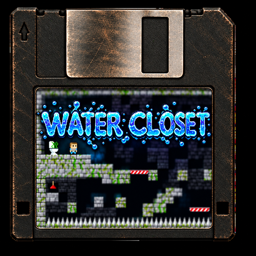

# TreeFrogUI Ports Collection

This repository distributes standalone game ports for TreeFrogUI devices. Each
port has its own folder under `ports/`, with its launcher metadata, executable
or Libretro core, and artwork. Libretro cores used by a port live inside that
port folder. General purpose cores such as OpenBOR remain in TreeFrogUI's core
collection. Game data is supplied by users and is not included in these
archives.

## Supported ports

### Standalone ports

<table>
  <tr>
    <td align="center"><a href="docs/setup/chocolatedoom.md"><br><strong>Chocolate Doom</strong></a></td>
    <td align="center"><a href="docs/setup/classicube.md"><br><strong>ClassiCube</strong></a></td>
    <td align="center"><a href="docs/setup/hexahop.md"><br><strong>Hex-a-hop</strong></a></td>
    <td align="center"><a href="docs/setup/nikwi.md"><br><strong>Nikwi Deluxe</strong></a></td>
    <td align="center"><a href="docs/setup/sdlzombies.md"><br><strong>SDL Zombies</strong></a></td>
    <td align="center"><a href="docs/setup/tinystg.md"><br><strong>TinySTG</strong></a></td>
    <td align="center"><a href="docs/setup/watercloset.md"><br><strong>Water Closet</strong></a></td>
  </tr>
</table>

### Ports requiring game data

<table>
  <tr>
    <td align="center"><a href="docs/setup/openclaw.md"><br><strong>Captain Claw</strong></a></td>
    <td align="center"><a href="docs/setup/diablo.md"><br><strong>Diablo 1</strong></a></td>
    <td align="center"><a href="docs/setup/duke3d.md"><br><strong>Duke Nukem 3D</strong></a></td>
    <td align="center"><a href="docs/setup/froggymania.md"><br><strong>FroggyMania</strong></a></td>
    <td align="center"><a href="docs/setup/hcl.md"><br><strong>Hydra Castle Labyrinth</strong></a></td>
    <td align="center"><a href="docs/setup/mcpe.md"><br><strong>Minecraft PE</strong></a></td>
  </tr>
  <tr>
    <td align="center"><a href="docs/setup/openlara.md"><br><strong>OpenLara</strong></a></td>
    <td align="center"><a href="docs/setup/spacecadet.md"><br><strong>Space Cadet Pinball</strong></a></td>
    <td align="center"><a href="docs/setup/sorr.md"><br><strong>Streets of Rage Remake</strong></a></td>
    <td align="center"><a href="docs/setup/undertale.md"><br><strong>Undertale</strong></a></td>
    <td align="center"><a href="docs/setup/vvvvvv.md"><br><strong>VVVVVV</strong></a></td>
  </tr>
</table>

### Synaps33 source forks

- [FroggyCraft](https://github.com/Synaps33/FroggyCraft) — ClassiCube
- [FroggyDuke](https://github.com/Synaps33/FroggyDuke) — Duke Nukem 3D
- [FroggyMania](https://github.com/Synaps33/FroggyMania) — FroggyMania
- [FroggyPE](https://github.com/Synaps33/FroggyPE) — Minecraft PE
- [FroggySpacePinbal](https://github.com/Synaps33/FroggySpacePinbal) — Space Cadet Pinball
- [FroggyTale](https://github.com/Synaps33/FroggyTale) — Undertale

## Contributors

- [Synaps33](https://github.com/Synaps33) — upstream game forks adapted for these ports; see the source links above.
- [Kryptikone316](https://github.com/Kryptikone316) — Hydra Castle Labyrinth, Hex-a-hop, and SDL Zombies ([PRs #1](https://github.com/tzubertowski/TreeFrogUI_PortsCollection/pull/1), [#2](https://github.com/tzubertowski/TreeFrogUI_PortsCollection/pull/2), [#3](https://github.com/tzubertowski/TreeFrogUI_PortsCollection/pull/3), [#5](https://github.com/tzubertowski/TreeFrogUI_PortsCollection/pull/5)).
- [Maheshivara](https://github.com/Maheshivara) — base box art and automatic port-table updates ([PRs #6](https://github.com/tzubertowski/TreeFrogUI_PortsCollection/pull/6), [#7](https://github.com/tzubertowski/TreeFrogUI_PortsCollection/pull/7)).

## How to install

### TreeFrogUI Installer

Use the [TreeFrogUI Installer](https://github.com/tzubertowski/TreeFrogUI-installer/releases/latest)
to install or update TreeFrogUI. Choose the **Install ports** option and select
whether to install **standalone** ports, ports **requiring game data**, or both.
The Installer places ports in `roms/ports/` and includes the setup help images.

### Manual installation

Download the latest release from [Releases](https://github.com/tzubertowski/TreeFrogUI_PortsCollection/releases/latest).
Extract the chosen archive to the SD card root, preserving its directory
structure:

- `TreeFrogUI-Ports-standalone.zip` contains ports that need no extra game data.
- `TreeFrogUI-Ports-requiring-game-data.zip` contains ports that need files from
  the user's own game installations.

To install both groups, extract both archives to the SD root. Then follow the
port-specific setup guide linked in each port's missing-files screen and copy
the required files into `roms/ports/<port-id>/`. Select the port's `.sh` entry
under **Games → Ports** to launch it.

## For port developers

Every port has one folder under `ports/`. That folder holds the code and files
needed to run the port. The release builder creates the visible
`roms/ports/<Name>.sh` launcher for you; it calls that port's `run.sh`.

### Two examples from this repository

**Native executable: Diablo 1**

```text
ports/diablo/
├── .requires_game_data       # empty marker: user must supply game data
├── boxart.png                # shown beside the launcher
├── config.json               # port metadata and launch description
├── devilutionx               # device executable
├── devilutionx.mpq           # open-source engine data
├── install.png               # optional QR shown on the missing-files screen
├── run.sh                    # checks data, sets runtime environment, starts it
└── source/                   # pinned Git submodule
```

Its `config.json` is:

```json
{
  "schema_version": 1,
  "id": "diablo",
  "name": "Diablo 1",
  "launcher": "Diablo 1.sh",
  "launch": {
    "type": "native",
    "binary": "devilutionx",
    "args": ["--verbose", "--diablo", "-n"]
  },
  "required_file_sets": [["DIABDAT.MPQ"]],
  "setup_guide": "docs/setup/diablo.md",
  "setup_guide_url": "https://github.com/tzubertowski/TreeFrogUI_PortsCollection/blob/main/docs/setup/diablo.md"
}
```

The user copies `DIABDAT.MPQ` into `roms/ports/diablo/`. `run.sh` calls
TreeFrogUI's shared checker before starting the native executable. The game
archive is not included in this repository or its release archives.

**Libretro core: ClassiCube**

```text
ports/classicube/
├── audio/default.zip          # runtime assets shipped with the port
├── boxart.png
├── ClassiCube.classicube      # content file passed to the core
├── classicube_libretro.so     # device Libretro core
├── config.json
├── run.sh                     # starts picoarch with this core and content
├── source/                    # pinned Git submodule
└── texpacks/default.zip
```

Its launch metadata is:

```json
{
  "schema_version": 1,
  "id": "classicube",
  "name": "ClassiCube",
  "launcher": "ClassiCube.sh",
  "launch": {
    "type": "libretro",
    "binary": "classicube_libretro.so",
    "content": "ClassiCube.classicube"
  },
  "required_file_sets": [],
  "setup_guide": "docs/setup/classicube.md",
  "setup_guide_url": "https://github.com/tzubertowski/TreeFrogUI_PortsCollection/blob/main/docs/setup/classicube.md"
}
```

For a Libretro port, `run.sh` starts TreeFrogUI's `picoarch` with the
port-local `.so` and the content file. ClassiCube has no user game-data
requirement, so it has no `.requires_game_data` marker and no missing-files
check.

### What each field means

| Field | What to put there |
|---|---|
| `schema_version` | `1` for the current config format. |
| `id` | The port folder name, in lowercase, such as `mygame`. This becomes its install folder. |
| `name` | Friendly name shown in TreeFrogUI. |
| `launcher` | Unique visible root entry ending in `.sh`, such as `My Game.sh`. The release builder generates this wrapper. |
| `launch.type` | `native` for a standalone device executable, or `libretro` for a core started through `picoarch`. |
| `launch.binary` | Filename of the port-local executable or core. Libretro cores must end in `_libretro.so`. |
| `launch.content` | Optional port-local marker/content filename passed to the game. It must be included in the port folder or listed among required game files. |
| `launch.args` | Optional extra arguments for a native executable. `run.sh` is the actual device launch command and must match this config. |
| `required_file_sets` | User-provided game files. An empty list means no extra game data. Each inner list is one complete acceptable set; multiple inner lists allow alternative file layouts. |
| `setup_guide` | Repository path to the port's readable setup guide, usually `docs/setup/<id>.md`. |
| `setup_guide_url` | HTTPS link to that guide. The missing-files screen opens this link's QR code. |

### Add a port

1. **Pin the source.** Add its source repository as a Git submodule at
   `ports/<id>/source`. The committed submodule pointer pins the exact source
   revision used for the port:

   ```sh
   git submodule add https://github.com/OWNER/PROJECT.git ports/mygame/source
   ```

2. **Add the device files.** Put the executable or Libretro core, content or
   marker files, runtime assets, `run.sh`, `config.json`, and `boxart.png` in
   `ports/<id>/`. Do not put binaries in TreeFrogUI's general `cubegm/cores`
   directory. Preserve the source project's license and add a license file when
   needed. The source submodule is recorded in Git but excluded from release
   archives.

3. **Write `run.sh`.** Make it executable (`chmod +x ports/<id>/run.sh`). For a
   native port, set its working directory and environment as needed, then
   `exec "$PORT_DIR/<binary>" ...`. For a Libretro port, use
   `exec /mnt/sdcard/cubegm/picoarch "$PORT_DIR/<core>_libretro.so" "$PORT_DIR/<content>"`.
   Use the existing Diablo and ClassiCube scripts above as working examples.

4. **Declare user game data when needed.** Add an empty
   `ports/<id>/.requires_game_data` file and list the required relative paths in
   `required_file_sets`. Call TreeFrogUI's shared
   `/mnt/sdcard/cubegm/port_check.sh` from `run.sh` before starting the game,
   passing the port id, setup guide URL, installed `install.png` path, port data
   folder, and required filenames. Do not add copyrighted game files to Git or
   either release archive. Ports needing data must include a clear guide in
   `docs/setup/` that tells users exactly which files to copy and where, plus an
   `install.png` QR code linking to that guide.

5. **Add artwork and setup help.** `boxart.png` is required and appears in the
   ports list. Game-data ports need `install.png` so the missing-files screen
   can show a QR code for the setup guide. It is installed at
   `frogui/port-help/<id>.png`. Ports with no missing-files setup may omit it.
   Make sure `setup_guide_url` points to the guide in this repository.

6. **Validate and build.** From the repository root, run:

   ```sh
   python3 tools/validate_ports.py
   python3 tools/build_release.py
   ```

   The validator checks the config, binary architecture, source submodule,
   launcher, artwork, guide, and required-file declarations. The builder
   creates the standalone and requiring-game-data archives, generates each
   visible root launcher, and places port files under `roms/ports/<id>/`.

Run the validation and build before submitting changes:

```sh
python3 tools/validate_ports.py
python3 tools/build_release.py
```

Pull requests and pushes run validation. Every push to `main` also creates a
GitHub release with the two archives.
